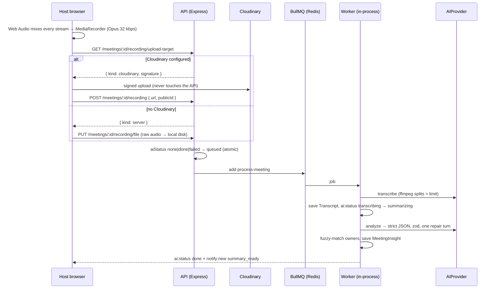

# IntellMeet — Architecture Notes

Living document. Each section is added in the phase that makes it real.

---

## Real-time media: mesh today, SFU later

### What is running now

IntellMeet uses a **full WebRTC mesh**. Every participant opens one
`RTCPeerConnection` to every other participant, and media flows directly
between browsers. The backend's only job is introductions: it relays SDP
offers, answers and ICE candidates without ever parsing them
(`server/src/sockets/socket.handlers.ts`), and never sees a frame of video.

```
        Socket.io (signalling only)
        ┌──────────────────────────┐
        │        Render API        │
        └──────────────────────────┘
           ▲        ▲        ▲
           │        │        │        (SDP / ICE)
     ┌─────┴──┐ ┌───┴────┐ ┌─┴──────┐
     │  Ada   │◄┤ Grace  ├►│  Alan  │
     └────┬───┘ └────┬───┘ └───┬────┘
          └──────────┴─────────┘
             media, peer to peer
```

**Why a mesh first.** It costs nothing to run. Media never touches a server, so
the free Render tier stays viable no matter how many meetings happen at once,
and there is no media server to operate, scale or pay for. For the two-to-six
person meetings this product is aimed at, it also gives the lowest possible
latency, because packets take the shortest path rather than a detour through a
relay.

**What it costs.** Upstream bandwidth grows linearly with the number of
participants. With *n* people, each browser encodes and uploads its stream
*n − 1* times:

| Participants | Uplink per person (≈1.5 Mbps stream) | Encodes |
| --- | --- | --- |
| 2 | 1.5 Mbps | 1 |
| 4 | 4.5 Mbps | 3 |
| 6 | 7.5 Mbps | 5 |
| 10 | 13.5 Mbps | 9 |

A typical home connection has 5–20 Mbps of upload, and a laptop starts dropping
frames well before the network does. Six is where quality becomes visibly
worse, which is why the room shows a warning above that number rather than
silently degrading.

### The upgrade path: an SFU

A **Selective Forwarding Unit** ends the fan-out. Each browser uploads *once*,
to the SFU, which forwards the stream to everyone else. Uplink stops growing
with participant count, so thirty people in a room costs each of them the same
as two.

```
     ┌────────┐   ┌────────┐   ┌────────┐
     │  Ada   │   │ Grace  │   │  Alan  │
     └───┬────┘   └───┬────┘   └───┬────┘
         └────────────┼────────────┘
                 ┌────▼─────┐
                 │  LiveKit │   one upload each, fan-out here
                 └──────────┘
```

**The chosen implementation is [LiveKit](https://livekit.io).** It is open
source and self-hostable, so there is no vendor lock-in, and LiveKit Cloud has
a free tier that removes the need to operate it at all while the project is
small. Its client SDK models a room as "participants publishing tracks", which
is close enough to the existing interface that the swap is contained.

**What makes the swap cheap.** Everything above the transport already talks
through `MediaTransport` (`client/src/lib/webrtc/types.ts`):

```ts
interface MediaTransport {
  start(localStream: MediaStream): void;
  replaceVideoTrack(track: MediaStreamTrack | null): Promise<void>;
  replaceAudioTrack(track: MediaStreamTrack | null): Promise<void>;
  close(): void;
}
```

The video grid, the controls and the participants panel know only about "peers
with streams". None of them knows that today there is one peer connection per
person. A `LiveKitTransport` implementing the same interface replaces
`MeshTransport` in `useMeetingRoom`, and the UI is untouched.

**What would still have to change:**

1. **Token minting.** LiveKit authenticates with a signed JWT per participant.
   A `POST /api/rtc/token` endpoint would issue one after the same
   team-membership check `room:join` already performs.
2. **Signalling ownership.** LiveKit does its own signalling, so `rtc:offer`,
   `rtc:answer` and `rtc:ice-candidate` become dead code. Room membership,
   chat, presence and notifications stay exactly as they are — they are not
   WebRTC concerns.
3. **Recording gets easier, not harder.** Server-side egress replaces the
   browser-side `MediaRecorder` mix built in Phase 6. That removes the
   limitation that only the host can record (and must keep the tab open), and
   gives one track per speaker, which the transcript's speaker labels need.

**When to make the switch.** When meetings routinely exceed six people, or
when server-side recording is wanted. Neither is true yet, and an SFU
introduces a component that must be paid for, scaled and kept up — so the mesh
stays until the constraint is real.

---

## NAT traversal: STUN today, TURN when needed

WebRTC has to find a path between two browsers that are both behind home
routers. Three things can happen:

1. **Direct connection.** Both peers are reachable once they have discovered
   their public address. **STUN** is what tells them that address — a single
   UDP round trip to a public server, free, and all that is needed most of the
   time.
2. **Hole punching.** Both are behind NAT but their routers allow an inbound
   packet on a port they have just sent from. STUN still suffices.
3. **Neither works.** Symmetric NAT (which allocates a different external port
   per destination), or a corporate firewall that blocks UDP entirely. The
   peers cannot reach each other at all, and traffic has to be **relayed**
   through a **TURN** server.

IntellMeet currently ships **Google's public STUN only**. `GET
/api/rtc/ice-servers` returns `hasTurn: false`, and the room shows a banner
saying so rather than letting a call fail silently.

### When TURN becomes necessary

Roughly 10–20% of connections on the public internet need a relay. Concretely,
expect failures when:

- Someone joins from a **corporate or university network** that blocks UDP or
  forces traffic through a proxy.
- Someone joins over **mobile data** on a carrier using carrier-grade NAT,
  which is usually symmetric.
- Two participants are on **the same restrictive network** with client
  isolation enabled — common on guest WiFi.

Two laptops on one home WiFi, or a laptop and a phone on the same network,
connect on STUN alone. That is why local testing succeeds while a demo over a
conference network may not.

### Adding TURN

[Metered](https://www.metered.ca/tools/openrelay/) has a free tier of 500 MB of
relayed traffic per month, which is ample for demos (relay is only used for the
connections that need it). Add to `server/.env`:

```bash
TURN_URLS=turn:standard.relay.metered.ca:80,turns:standard.relay.metered.ca:443
TURN_USERNAME=<from the Metered dashboard>
TURN_CREDENTIAL=<from the Metered dashboard>
```

Restart the API. `hasTurn` becomes `true`, the banner disappears, and the
credential is served from the API at call time — never embedded in the client
bundle, which is public and would leak a relay somebody else pays for.

---

## Perfect negotiation

Two browsers in a mesh may both decide to renegotiate at the same instant — a
"glare" collision. It is not a rare edge case: starting a screen share
renegotiates, and two people doing that within a second of each other is
ordinary behaviour. Handled naively, both ends have an outstanding local offer,
both reject the other's, and the connection wedges until somebody reloads.

`MeshTransport` implements the WebRTC specification's **perfect negotiation**
pattern. Each peer pair has a *polite* and an *impolite* side, decided by
comparing socket ids — deterministic, and guaranteed opposite at the two ends.
On a collision the impolite peer ignores the incoming offer and proceeds with
its own; the polite peer accepts the incoming one and abandons its own. Exactly
one side gives way, so the pair always converges on a single negotiation.

The three flags that make it work (`makingOffer`, `ignoreOffer`,
`settingRemoteAnswerPending`) are not bookkeeping — they *are* the algorithm,
and `client/src/lib/webrtc/MeshTransport.test.ts` covers both sides of a
collision explicitly.

### Who offers at join time

Perfect negotiation makes collisions *survivable*; it does not make them
free. Phase 5 had both peers add their tracks the moment they learned about
each other, so **every join collided** and went through a rollback. Measured
in Phase 6, about one join in six then stalled: after rolling back its own
offer, Chrome's polite side intermittently never gathered ICE candidates for
its answer, ICE stayed in `new`, and nothing ever retried.

So a join no longer collides:

```
 newcomer                      server                      already here
    │── room:join ──────────────►│                              │
    │◄── room:participants ──────│── room:user-joined ─────────►│
    │  addPeer(initiator: true)  │      addPeer(initiator: false)│
    │  tracks added → offer ─────┼─────────────────────────────►│
    │                            │   tracks attached to the      │
    │◄───────────────────────────┼──────────── answer ───────────│
```

The newcomer offers, having just received the roster. Everyone already in the
room creates the connection when told somebody joined, but holds its tracks
until that offer arrives (`awaitingOffer`), then attaches them to the offered
transceivers and answers. That's one round trip with no rollback.

A **watchdog** covers anything that still goes wrong: a connection still in
`new` after 5s is either unblocked (a member still waiting stops waiting and
offers itself) or restarted (`restartIce()` from the impolite side only, so
the two ends do not collide again). The Playwright spec asserts `connected`
and decoded frames within 4.5s, under the watchdog's 5s, so a stall that
only the watchdog rescues still fails the test.

---

## Recording and the AI pipeline



- **Why the host's browser records.** In a mesh, no server ever hears
  everyone; the host's browser is the one place all the audio meets. An SFU
  would move this server-side (LiveKit egress), which would also allow
  per-speaker tracks and fix the missing speaker labels in Whisper
  transcripts.
- **Why the queue sits behind an interface.** BullMQ needs a real Redis for
  its Lua scripts. The unit suite has none, so it uses a `MemoryQueue` and
  calls the job body directly. The e2e recording test runs the real BullMQ
  path.
- **Providers are swappable by configuration.** `AI_PROVIDER=mock | groq |
  gemini`; Groq plus a Gemini key gives an automatic fallback per call.
  Prompting, validation and repair are shared by every LLM provider, so they
  are tested once.
- **Failure handling.** 429/5xx/network errors retry with exponential backoff.
  Permanent errors (deleted meeting, missing file, rejected key) stop at once.
  The final failure stores a UI-safe message built from status codes, never
  from provider responses.
