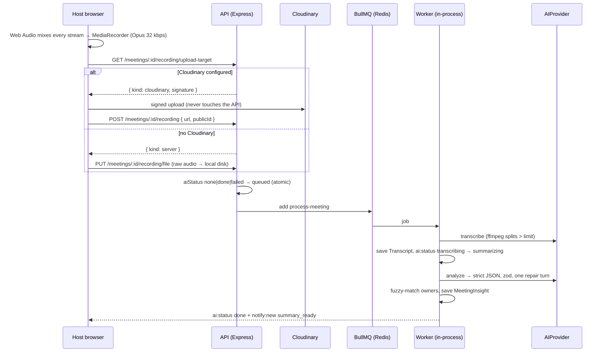
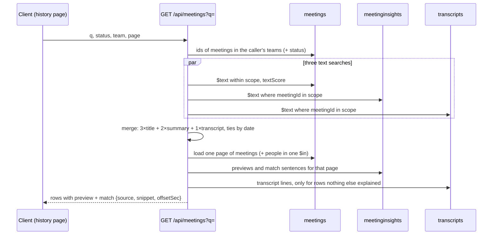
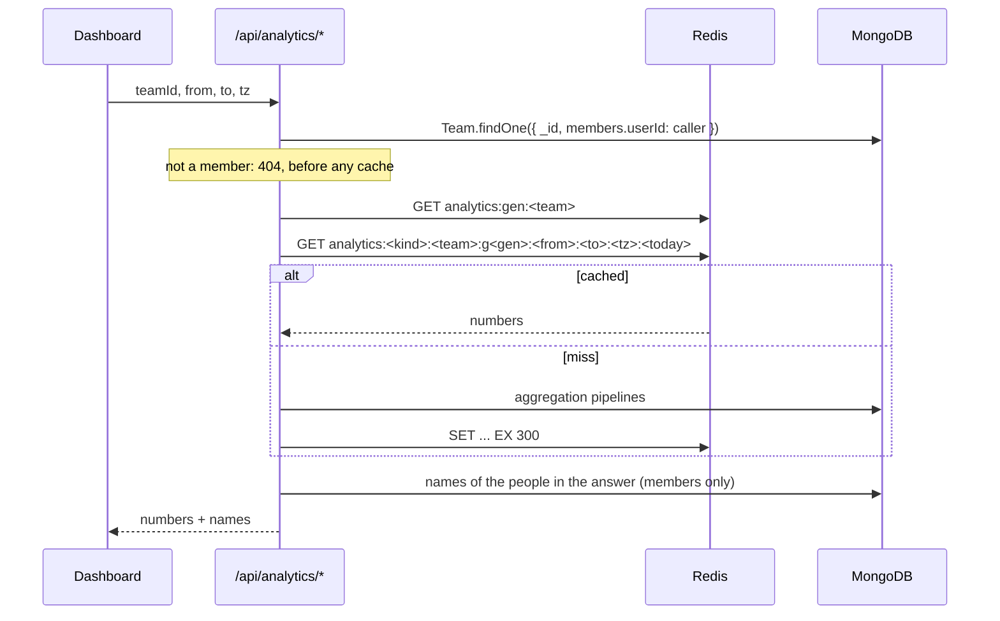

# IntellMeet — Architecture Notes

Living document. Each section is added in the phase that makes it real.

---

## Real-time media: mesh today, SFU later

### What is running now

IntellMeet uses a **full WebRTC mesh**. Every participant opens one
`RTCPeerConnection` to every other participant, and media flows directly
between browsers. The backend's only job is introductions: it relays SDP
offers, answers and ICE candidates without ever parsing them
(`server/src/sockets/socket.handlers.ts`), and never sees a frame of video.

```
        Socket.io (signalling only)
        ┌──────────────────────────┐
        │        Render API        │
        └──────────────────────────┘
           ▲        ▲        ▲
           │        │        │        (SDP / ICE)
     ┌─────┴──┐ ┌───┴────┐ ┌─┴──────┐
     │  Ada   │◄┤ Grace  ├►│  Alan  │
     └────┬───┘ └────┬───┘ └───┬────┘
          └──────────┴─────────┘
             media, peer to peer
```

**Why a mesh first.** It costs nothing to run. Media never touches a server, so
the free Render tier stays viable no matter how many meetings happen at once,
and there is no media server to operate, scale or pay for. For the two-to-six
person meetings this product is aimed at, it also gives the lowest possible
latency, because packets take the shortest path rather than a detour through a
relay.

**What it costs.** Upstream bandwidth grows linearly with the number of
participants. With *n* people, each browser encodes and uploads its stream
*n − 1* times:

| Participants | Uplink per person (≈1.5 Mbps stream) | Encodes |
| --- | --- | --- |
| 2 | 1.5 Mbps | 1 |
| 4 | 4.5 Mbps | 3 |
| 6 | 7.5 Mbps | 5 |
| 10 | 13.5 Mbps | 9 |

A typical home connection has 5–20 Mbps of upload, and a laptop starts dropping
frames well before the network does. Six is where quality becomes visibly
worse, which is why the room shows a warning above that number rather than
silently degrading.

### The upgrade path: an SFU

A **Selective Forwarding Unit** ends the fan-out. Each browser uploads *once*,
to the SFU, which forwards the stream to everyone else. Uplink stops growing
with participant count, so thirty people in a room costs each of them the same
as two.

```
     ┌────────┐   ┌────────┐   ┌────────┐
     │  Ada   │   │ Grace  │   │  Alan  │
     └───┬────┘   └───┬────┘   └───┬────┘
         └────────────┼────────────┘
                 ┌────▼─────┐
                 │  LiveKit │   one upload each, fan-out here
                 └──────────┘
```

**The chosen implementation is [LiveKit](https://livekit.io).** It is open
source and self-hostable, so there is no vendor lock-in, and LiveKit Cloud has
a free tier that removes the need to operate it at all while the project is
small. Its client SDK models a room as "participants publishing tracks", which
is close enough to the existing interface that the swap is contained.

**What makes the swap cheap.** Everything above the transport already talks
through `MediaTransport` (`client/src/lib/webrtc/types.ts`):

```ts
interface MediaTransport {
  start(localStream: MediaStream): void;
  replaceVideoTrack(track: MediaStreamTrack | null): Promise<void>;
  replaceAudioTrack(track: MediaStreamTrack | null): Promise<void>;
  close(): void;
}
```

The video grid, the controls and the participants panel know only about "peers
with streams". None of them knows that today there is one peer connection per
person. A `LiveKitTransport` implementing the same interface replaces
`MeshTransport` in `useMeetingRoom`, and the UI is untouched.

**What would still have to change:**

1. **Token minting.** LiveKit authenticates with a signed JWT per participant.
   A `POST /api/rtc/token` endpoint would issue one after the same
   team-membership check `room:join` already performs.
2. **Signalling ownership.** LiveKit does its own signalling, so `rtc:offer`,
   `rtc:answer` and `rtc:ice-candidate` become dead code. Room membership,
   chat, presence and notifications stay exactly as they are — they are not
   WebRTC concerns.
3. **Recording gets easier, not harder.** Server-side egress replaces the
   browser-side `MediaRecorder` mix built in Phase 6. That removes the
   limitation that only the host can record (and must keep the tab open), and
   gives one track per speaker, which the transcript's speaker labels need.

**When to make the switch.** When meetings routinely exceed six people, or
when server-side recording is wanted. Neither is true yet, and an SFU
introduces a component that must be paid for, scaled and kept up — so the mesh
stays until the constraint is real.

---

## NAT traversal: STUN, and TURN for the networks that need it

WebRTC has to find a path between two browsers that are both behind home
routers. Three things can happen:

1. **Direct connection.** Both peers are reachable once they have discovered
   their public address. **STUN** is what tells them that address — a single
   UDP round trip to a public server, free, and all that is needed most of the
   time.
2. **Hole punching.** Both are behind NAT but their routers allow an inbound
   packet on a port they have just sent from. STUN still suffices.
3. **Neither works.** Symmetric NAT (which allocates a different external port
   per destination), or a corporate firewall that blocks UDP entirely. The
   peers cannot reach each other at all, and traffic has to be **relayed**
   through a **TURN** server.

`GET /api/rtc/ice-servers` always returns Google's public STUN servers, and a
TURN relay when one is configured. **Production has one: Metered** (since
Phase 12), so `hasTurn` is `true` there. Without TURN (local development, by
default) it is `false`, and the room shows a notice saying so rather than
letting a call fail silently.

### When TURN is necessary

Roughly 10–20% of connections on the public internet need a relay. Concretely,
without one, expect failures when:

- Someone joins from a **corporate or university network** that blocks UDP or
  forces traffic through a proxy.
- Someone joins over **mobile data** on a carrier using carrier-grade NAT,
  which is usually symmetric.
- Two participants are on **the same restrictive network** with client
  isolation enabled — common on guest WiFi.

Two laptops on one home WiFi, or a laptop and a phone on the same network,
connect on STUN alone. That is why local testing succeeds while a demo over a
conference network may not.

### The relay in production

[Metered](https://www.metered.ca)'s free plan relays 500 MB a month (the
conservative figure; see `docs/deployment.md`), which covers demos because
only the connections that need a relay use it. Production offers four URLs,
so at least one gets through almost any network:

| URL | For |
| --- | --- |
| `turn:global.relay.metered.ca:80` | UDP, the fastest, where UDP is allowed |
| `turn:global.relay.metered.ca:80?transport=tcp` | networks that block UDP |
| `turn:global.relay.metered.ca:443` | UDP on port 443 |
| `turns:global.relay.metered.ca:443?transport=tcp` | TLS on 443: looks like HTTPS, which college and office firewalls let out |

All four were checked before launch: a headless Chromium forced to relay-only
set up a relay on each. The URLs are in `render.yaml`; the username and
credential are Render secrets, served by the API at call time (to signed-in
users, cached privately for 60 s) and never embedded in the public bundle.
A signed-in user can still read them, which is how TURN works; the free
plan's hard stop at its quota bounds the cost of misuse.

Locally, the same three variables in `server/.env` switch it on
(`TURN_URLS`, `TURN_USERNAME`, `TURN_CREDENTIAL`; see `server/.env.example`).

---

## Perfect negotiation

Two browsers in a mesh may both decide to renegotiate at the same instant — a
"glare" collision. It is not a rare edge case: starting a screen share
renegotiates, and two people doing that within a second of each other is
ordinary behaviour. Handled naively, both ends have an outstanding local offer,
both reject the other's, and the connection wedges until somebody reloads.

`MeshTransport` implements the WebRTC specification's **perfect negotiation**
pattern. Each peer pair has a *polite* and an *impolite* side, decided by
comparing socket ids — deterministic, and guaranteed opposite at the two ends.
On a collision the impolite peer ignores the incoming offer and proceeds with
its own; the polite peer accepts the incoming one and abandons its own. Exactly
one side gives way, so the pair always converges on a single negotiation.

The three flags that make it work (`makingOffer`, `ignoreOffer`,
`settingRemoteAnswerPending`) are not bookkeeping — they *are* the algorithm,
and `client/src/lib/webrtc/MeshTransport.test.ts` covers both sides of a
collision explicitly.

### Who offers at join time

Perfect negotiation makes collisions *survivable*; it does not make them
free. Phase 5 had both peers add their tracks the moment they learned about
each other, so **every join collided** and went through a rollback. Measured
in Phase 6, about one join in six then stalled: after rolling back its own
offer, Chrome's polite side intermittently never gathered ICE candidates for
its answer, ICE stayed in `new`, and nothing ever retried.

So a join no longer collides:

```
 newcomer                      server                      already here
    │── room:join ──────────────►│                              │
    │◄── room:participants ──────│── room:user-joined ─────────►│
    │  addPeer(initiator: true)  │      addPeer(initiator: false)│
    │  tracks added → offer ─────┼─────────────────────────────►│
    │                            │   tracks attached to the      │
    │◄───────────────────────────┼──────────── answer ───────────│
```

The newcomer offers, having just received the roster. Everyone already in the
room creates the connection when told somebody joined, but holds its tracks
until that offer arrives (`awaitingOffer`), then attaches them to the offered
transceivers and answers. That's one round trip with no rollback.

A **watchdog** covers anything that still goes wrong: a connection still in
`new` after 5s is either unblocked (a member still waiting stops waiting and
offers itself) or restarted (`restartIce()` from the impolite side only, so
the two ends do not collide again). The Playwright spec asserts `connected`
and decoded frames within 4.5s, under the watchdog's 5s, so a stall that
only the watchdog rescues still fails the test.

---

## Recording and the AI pipeline



- **Why the host's browser records.** In a mesh, no server ever hears
  everyone; the host's browser is the one place all the audio meets. An SFU
  would move this server-side (LiveKit egress), which would also allow
  per-speaker tracks and fix the missing speaker labels in Whisper
  transcripts.
- **Why the queue sits behind an interface.** BullMQ needs a real Redis for
  its Lua scripts. The unit suite has none, so it uses a `MemoryQueue` and
  calls the job body directly. The e2e recording test runs the real BullMQ
  path.
- **Providers are swappable by configuration.** `AI_PROVIDER=mock | groq |
  gemini`; production uses Gemini (Phase 11): `GEMINI_MODEL`, then each of
  `GEMINI_FALLBACK_MODELS` (the free tier's 20 requests a day are per
  model, so a chain multiplies them), and Groq plus a Gemini key gives a
  fallback per call too. Prompting, validation and repair are shared by every LLM
  provider, so they are tested once.
- **Failure handling, in three layers.** A 429/5xx is first retried once
  inside the call (3 s, or the vendor's own `Retry-After`/`retryDelay` up to
  20 s; a longer ask means out of quota, so it fails at once); then the next
  model or provider takes over (between models, not for a 400 or 401, which
  every model would repeat); then the job itself retries with exponential
  backoff, network errors included.
  Permanent errors (deleted meeting, missing file, rejected key) stop at once.
  The final failure stores a UI-safe message built from status codes, never
  from provider responses. A job lost with the queue (a Redis restart) is
  failed by the housekeeping sweep instead (see "AI runs whose job was
  lost").
- **The API downloads only its own recordings.** `POST
  /meetings/:id/recording` names a Cloudinary URL that the server will later
  fetch, so it is an SSRF surface. Since Phase 12 it accepts only the exact
  delivery URL of the named asset: `https://res.cloudinary.com/<cloud>/video/upload/[v<n>/]intellmeet/recordings/<id>.<ext>`,
  parsed and normalised first, with no port, login, query or fragment, no
  transformation and no fetch URL (which would make Cloudinary download any
  address for us). The download refuses redirects and gives up after two
  minutes, and a recording already attached to another meeting is refused.
- **Recordings leave with their meeting.** Deleting a meeting (by its host,
  the demo cleanup, or a guest ending their session) destroys its Cloudinary
  asset too, as does replacing a recording. A Cloudinary failure never
  blocks the deletion (each call gives up after 10 s): it is logged with the
  asset's id for removal by hand. Only ids inside `intellmeet/recordings/`
  are ever destroyed, whatever the database says.

---

## Meeting history search

The words a person remembers from a meeting are rarely in its title. Search
therefore covers the three places text lives, each with its own MongoDB text
index (one per collection is all Mongo allows):

| Collection | Indexed fields | Weight in the ranking |
| --- | --- | --- |
| `meetings` | title, description | ×3 |
| `meetinginsights` | summary, key decisions | ×2 |
| `transcripts` | full text | ×1 |



**Authorisation is the scope, applied first.** Insights and transcripts span
every tenant, so their searches are restricted to the caller's meeting ids
before ranking. Searching them unscoped and filtering afterwards would rank
other teams' meetings and could crowd the caller's out of the candidate limit
(200 per index). At larger scale the next step is to copy `teamId` onto
insights and transcripts and make it a prefix of their text indexes.

**Why the server explains each match.** A text index says *that* a document
matched, not *where*. For the page being returned, the server re-finds the
query's words — summary sentence first, then decisions, then a transcript line
(with its timestamp, so the row can link to that moment). Mongo stems words
("planning" matches "we planned"), so the server and the client share one
small approximation in `shared/src/search.ts`: the snippet the server picks and
the words the client highlights always agree.

---

## Demo identity: a guest per sign-in

`POST /api/auth/demo` creates a guest account for every sign-in rather than
handing everyone one shared account:

```
Try Live Demo ──► createDemoGuest()
                    ├─ name: colour + animal, no word shared with the team
                    ├─ authProvider "guest", no password, @guest.intellmeet.invalid
                    ├─ member (not admin) of the seeded demo team
                    └─ ceiling: DEMO_MAX_GUESTS
                  startSession() ──► access token + refresh cookie
```

Everything else — host checks, notifications, AI owner matching — already
keyed on the user id, so making each reviewer a real user fixed "two windows
are the same person" without special cases anywhere else.

A guest can never sign back in once its session ends, so whatever it hosted
would become unmanageable. `removeGuests()` (in the demo cleanup module)
therefore deletes a guest together with the meetings it hosted and the teams
it owned, whatever their age, and takes it out of every team's member list. It
runs from two places: the periodic sweep, for guests idle longer than
`DEMO_DATA_TTL_HOURS` (idle meaning no refresh token issued since the cutoff),
and `DELETE /api/auth/demo`, when a guest ends their own session.

---

## Email sign-in codes

Sign-up and sign-in by a six-digit code sent to the person's address. The
password flow stays; the code flow is a second way to the same session
(`startSession()`: the same access token, the same rotating refresh cookie).

```
/login  or  /register
   │  POST /api/auth/code { purpose, email, name? }
   │    limits ─► outcomeFor(address) ─► one email ─► 202, the same for every address
   │         code        an account to sign in to, or an address to sign up
   │         no-account  asked to sign in, none exists: "create one here"
   │         has-account asked to sign up, one exists: "sign in here"
   │         (nothing)   the seeded team-mates, guests, a demo account
   ▼
   │  POST /api/auth/code/verify { email, code }
   │    findOneAndUpdate (live, attempts < max, $inc attempts) ─► HMAC compare
   │    ─► conditional delete (spend) ─► accountFor(): create, or claim ─► startSession()
```

### Decisions

| Decision | Why |
| --- | --- |
| **One document per address in MongoDB, not Redis** | Render's free Key Value keeps nothing on disk, so a restart would turn every code in flight into "invalid". A document per address (unique index) means requesting another code *replaces* the first: only the newest works, and an old email cannot be used after a new one. A TTL index removes what nobody entered; every query also filters on `expiresAt`, because the TTL monitor runs about once a minute. |
| **An HMAC of the code, keyed with `JWT_SECRET` and bound to the address** | Six digits have a million values, so a plain SHA-256 of one is undone by trying them all. Keyed, a database dump alone cannot be used to recover a code or to carry one from one address to another. It is the layer behind the short life and the guess limit, not instead of them. |
| **The guess counter is incremented by the query that finds the code** | Counting after the lookup would let a burst of parallel requests each read `attempts: 0` and each be evaluated. With `$inc` in the `findOneAndUpdate` and `attempts < max` in its filter, a code at its ceiling is never evaluated, whether or not the request that reached it has deleted it yet (a test sets that state directly; removing the filter fails it). |
| **A correct code is spent by a conditional delete** | `deleteOne({ _id, codeHash })` and a check that it deleted one: of two simultaneous requests with the right code, one gets a session and the other a 401 (tested). |
| **The response never depends on whether an account exists** | Every address gets `202 { expiresInSec, resendAfterSec }`. The *email* differs, so the person always learns what to do, and a stranger typing addresses into the form learns nothing. The cost is that an unknown address that asks to sign in is sent an email, bounded by the limits below. |
| **The cooldown is a rate limiter, not a field on the code** | A cooldown read from the stored code would exist only for addresses that have one, and the difference in the answer (60 s left against a fresh 60) would tell a stranger which addresses those are. A limiter keyed on the address applies to every address alike. It counts only requests that worked (`skipFailedRequests`), so a failed send can be retried at once. |
| **Limits in layers, and the order matters** | Per IP first (before parsing); then validation; then per address (1 per `LOGIN_CODE_RESEND_SEC`, 5 per 15 minutes); then the whole server's `EMAIL_DAILY_LIMIT` *last*, so malformed requests and repeats for one address are refused before they spend it. The daily ceiling answers **503**, not 429: the person did nothing wrong, the day's allowance (Brevo's free 300) is spent, and passwords and the demo still work. |
| **Never for the seeded team-mates, the demo persona or guests** | Their addresses are made up (`@intellmeet.app`, `.invalid`). If anyone came to own that domain, a code would be a way into the shared demo accounts. `authProvider` must also be `local`. Checked again when the code is spent, because the account can change in between. |
| **A code proves the address, so it takes over an unproven account** | `POST /api/auth/register` never verified the address. Someone could register `victim@example.com` with a password only they know and wait; if the victim then signed in with a code, they would land in an account the attacker could still enter. So the first proof of an address marks the account verified (`emailVerifiedAt`) and removes its password and every session. The account and its data stay. A person who made a password account with their own address loses the password the first time they use a code, which is the price of not being able to tell them from the attacker. |
| **Brevo over HTTPS, not SMTP** | Render's free web services block outbound SMTP ports since 26 September 2025, so a mail library would time out in production and work on a laptop. The provider interface (`lib/email`, like `lib/ai`) has `console` for development and tests and `brevo` for production. |
| **`console` is refused in production** | It prints the code to the log. In production that would deliver nothing and write every sign-in code where anyone with log access can read it, so the endpoints answer 503 with a plain message until a real provider is set. |
| **The code is not in the subject line** | A subject shows on a lock screen and in a notification. |
| **Nothing user-supplied in any email** | No name, no address in the body: nothing to escape. The variables are digits, a number of minutes and two URLs built from `CLIENT_URL`. |

### Not covered

- **Mail deliverability is not tested.** The suite stubs the provider and the
  Brevo request; whether a message reaches an inbox (and not spam) depends on
  the sender address Brevo has validated, and has to be checked live.
- **The daily ceiling can be spent by a determined caller** with many
  addresses and many networks (each IP is limited to 10 requests per 15
  minutes). The effect is that code sign-in answers 503 until the window ends;
  nothing else stops. That is a limit of a free plan, not something closed here.
- **No end-to-end test** of the whole flow in a browser: it needs the code from
  a mailbox, and the suite has none. The screens are covered by component
  tests and the axe pass; the API by supertest.
- **`POST /api/auth/register` still exists** (165 places in the test suite
  create their users with it). No screen uses it. It is the only way left to
  make an account with an unproven address, so retiring it, once the tests
  create users another way, would stop new ones appearing; the takeover rule
  would still be needed for the ones that exist.

---

## The housekeeping sweep

Small jobs that keep shared state honest run inside the web process
(`server/src/jobs/housekeeping.ts`): Render's free tier has no scheduler, and
none of them deserves a service of its own. Every job is idempotent, so two
instances running it at once waste a little effort rather than doing harm.

| Cadence | Job |
| --- | --- |
| 30 s after start, then every 5 min | End live meetings everybody has left; once a week, move the seeded history forward (see Analytics); put the demo board's sample tasks back once the board has been quiet; fail AI runs whose queue job was lost (below) |
| 1 min after start, then every `DEMO_CLEANUP_INTERVAL_MIN` (30) | Demo cleanup: idle guests with what they made (Cloudinary recordings included), stale demo content |

### AI runs whose job was lost

Production's Redis (Render Key Value, free) keeps nothing on disk, so a
restart empties the BullMQ queue. A meeting whose job was waiting or running
would then show "Transcribing" forever: the job that would move it on no
longer exists, and the host's Retry button only appears on a failed run.

`failLostAiRuns` (`modules/ai/ai.recovery.ts`) finds meetings in `queued`,
`transcribing` or `summarizing` whose status has not changed for 10 minutes,
asks the queue which meetings it still holds (one atomic read of every
pending state, so a job moving between states cannot look lost), and fails
the rest with "Processing was interrupted (the job queue restarted). Press
Retry to run it again." The update is conditional on the status and its
timestamp being unchanged, so a job that finishes at that moment wins. The
queue is only asked when something looks stale, and an index on `{aiStatus,
updatedAt}` keeps the check cheap.

### Ending meetings everybody has left

Only the host's **End for all** used to end a meeting, and plenty of meetings
never get one: the last person closes the tab, a laptop sleeps, the server
restarts. Those stayed Live forever.

```
join / leave ─────────► lastActiveAt = now          (meeting.service)
sweep, room occupied ─► lastActiveAt = now          (every 5 min)
sweep, room empty  ───► lastActiveAt older than LIVE_MEETING_IDLE_MIN (10)?
                          └─ yes: status ended, endedAt = lastActiveAt,
                                  open attendance closed, room state cleared
```

Two sources of truth, deliberately:

- **Who is connected** comes from Socket.io's own room membership, asked of
  every instance through the Redis adapter (`fetchSockets`), never from the
  Redis roster, which still lists everyone after a restart. If an instance
  does not answer, the meeting is left alone: unknown is not empty.
- **How long it has been empty** comes from `lastActiveAt`. After a restart
  the sockets are gone but the stamp is at most one sweep old, so a call that
  was running a minute ago is not ended while its people reconnect. One left
  live overnight is ended by the first sweep after startup.

`endedAt` is the last moment the room was known to be occupied, so the
history shows how long the meeting ran rather than how long nobody noticed.
The update is conditional on the meeting still being live with the same
`lastActiveAt`, so a join that lands between the check and the write wins.

**Reconnecting after a restart.** A reconnected socket is a new socket in no
rooms. The room page now joins again on every reconnect and rebuilds its mesh
(each peer connection was keyed to the old socket id). On every join the
server first drops roster entries whose socket is gone (`sockets/rooms.ts`)
and tells the room, so the newcomer never offers to a peer that died in the
restart, and the others lose the frozen tile. The sweep does the same for
rooms that stay occupied.

---

## Rate limits for a room of people behind one address

A panel of judges on a college or office network shares one public IP, and
so every per-IP limit. One demo session, counted from the client code:

| Action | Auth requests |
| --- | --- |
| Open the landing page (any full page load) | 1 `POST /auth/refresh` |
| Press **Try Live Demo** | 1 `POST /auth/demo` |
| Each reload, new tab, pasted invite or notification link opened in a new tab | +1 refresh |
| Each tab, every 15 minutes it is used (access token expiry) | +1 refresh |
| A second (private) window to meet yourself in a call | +1 refresh, +1 demo |

A 20-minute session with two windows and a couple of reloads is about nine
requests. Under the old shared budget of 30 per IP per 15 minutes, the fourth
judge on one network got a 429: on the landing page as "Too many requests",
and on a reload as being signed out (the client reads a failed refresh as "no
session").

| Limiter | Key | Budget (default / production) | Why |
| --- | --- | --- | --- |
| Refresh | IP | 600 / 15 min (`RATE_LIMIT_REFRESH_PER_15_MIN`) | Nothing to guess (256-bit tokens): it only bounds a runaway client or a flood |
| Demo sign-in | IP | 60 / 15 min (`RATE_LIMIT_DEMO_PER_15_MIN`) | Creates an account, so bounded twice: here, and for everyone by `DEMO_MAX_GUESTS` |
| Register + sign-in | IP | 30 / **60** per 15 min (`RATE_LIMIT_AUTH_PER_15_MIN`) | Each hashes a password (bcrypt: ~350 ms at cost 12 on a laptop, seconds on Render's 0.1 CPU). Every judge in a room also signs in as a seeded team-mate for a second window |
| Failed sign-in | IP + email | 5 / **10** per 15 min (`RATE_LIMIT_LOGIN_FAILURES_PER_15_MIN`) | Counts **failures only**: a correct password is not a guess. Several people mistyping one team-mate's password share it |
| Failed sign-in | **account**, any address | 30 / 15 min, fixed | The limit that holds against a guesser who can choose the address the API sees (below) |
| Board edits | account | 120 / min | Dragging cards is bursty; per account, so a room does not share it |
| Analytics reads | account | 120 / min | A range nobody has asked for is a cache miss that runs the aggregations; this bounds how many one person can start |

**Which address is "IP".** Behind Render, Express's `req.ip` is one of
Render's own proxies, and before Phase 12's fix every visitor in production
shared one or two buckets (measured). `lib/clientIp.ts` reads the visitor's
address from `CF-Connecting-IP`, which Cloudflare (in front of every Render
service) sets and a caller cannot forge, and, when the request came through
the Vercel rewrite, from the public address Vercel wrote just before it in
`X-Forwarded-For`. The address the API sees is then the same on both paths
(REST through Vercel, Socket.io direct). Its limit: a caller who skips Vercel
can put any address in that position and choose their bucket, which is why
the per-account limit above exists and why the demo has a global guest
ceiling. `docs/deployment.md` ("Client IP addresses") has the header chains
and the live measurements.

**Why refresh is not keyed on the session.** The refresh token rotates on
every call, so it is a different key each time. The only stable session key,
the family id, is known only after the database lookup the limiter protects,
and keying on the raw cookie would give every forged value a fresh bucket.

---

## Team boards and tasks (Phase 8)

```
Team 1───n Board ─── columns[{_id, title, isDone}]   (array order = display order)
             │
             1───n Task ─── columnId, order, assignee, dueDate, priority,
                   │        sourceMeetingId + sourceActionItemId, version
                   1───n TaskComment
MeetingInsight.actionItems[].taskId ──► Task          (both directions)
```

- **One default board per team**, created on first use (a partial unique
  index makes concurrent first visits create exactly one). Tasks from meeting
  action items go there. Admins may add more boards.
- **Columns are the team's workflow**, so only a team admin adds, renames,
  reorders (as a whole list, refused unless it is exactly the current set) or
  removes them (only when empty). "Done" is a flag, not a position: a task in a
  done column is never overdue, whatever the column is called.

### Fractional ordering

A card's `order` is a float. A drop is sent as the neighbours it landed
between (`afterId`, `beforeId`); the server reads their orders and stores the
midpoint, so **a move writes one document**. When repeated drops into one slot
have halved the gap below `MIN_ORDER_GAP` (about 30 drops), the column is
renumbered in steps of 1024 and the renumbered cards are returned with the
move. The same `orderBetween` runs in the browser for the optimistic update,
so the card is already where the server puts it.

Neighbours rather than an index or a number: a client whose board is a second
stale still lands the card next to the cards the person could see, and a
neighbour that has since moved away is simply ignored.

### A move, end to end

```mermaid
sequenceDiagram
    participant A as Window A
    participant API as API
    participant DB as MongoDB
    participant B as Window B (board room)

    A->>A: drop: moveLocally() in the query cache (optimistic)
    A->>API: POST /tasks/:id/move { columnId, afterId, beforeId }
    API->>DB: neighbours' orders -> midpoint (or renumber)
    API->>DB: $set columnId, order; $inc version
    API-->>A: { task, reordered }  (cache: replace if version >= ours)
    API-->>B: task:moved { task, reordered } to board:<id>
    B->>B: apply if version >= cached version
```

- **Board rooms.** A page showing a board joins `board:<id>`; the server
  checks team membership on every join, like a meeting room.
- **Versions.** Every write increments `version`. Events can arrive out of
  order (two moves of one card a few milliseconds apart), so a client never
  replaces a task with an older copy. The sender's own echo is recognised the
  same way, so the server needs no "which socket made this request".
- **Refresh, not patch, for broad changes.** Column changes, a demo-board reset
  and a guest leaving (taking its tasks) send `board:refresh`; viewers reload.
- **Reconnect.** A reconnected socket rejoins the board room and reloads once
  to catch up on what it missed.

### Who may do what

One rule, shared by the server (enforcement) and the page (what is offered):
`taskPermissions` in `shared/src/task.ts`.

| | Member | Team admin |
| --- | --- | --- |
| Create, move, comment | any task | any task |
| Edit | any task except a seeded sample | any |
| Delete | tasks they created | any |
| Boards and columns | - | yes |

### The shared demo board

Every judge is a guest member of the one seeded demo team, so they share its
board. The rules above already stop one judge breaking it for the next:
nobody but an admin (no guest is one) can edit or delete the samples, rename
or remove the columns, or delete another judge's tasks. Moving is the point of
a board, so moves are allowed and undone later instead: once the board has
been quiet (nothing created, changed, moved or commented) for
`DEMO_BOARD_RESET_IDLE_MIN` (60), the housekeeping sweep re-runs the seed for
the board, putting the samples back in place, with fresh relative due dates
and without the comments left on them. A board somebody is using is never
reset under them.

Seeded tasks, the columns and the sample action items all have ids derived
from stable keys (`stableObjectId`), so re-seeding updates rather than
duplicates and never breaks a link. Guest-created tasks and comments go with
the guest (end of session or the idle sweep); tasks others gave a guest stay,
unassigned. The demo cleanup never matches a seeded task (`deleteTasksWhere`
excludes them unless a whole board is being deleted).

### Action items into tasks

`POST /api/meetings/:id/tasks` turns one or many items into tasks at the
bottom of the team board's first column. The owner and deadline arrive
pre-filled from the AI's reading and can be changed in the dialog. Each task
keeps `sourceMeetingId` + `sourceActionItemId`, each item its `taskId`, and a
unique index on the pair means a double-click (or two people at once) makes
one task. The meeting page reads each linked task's column live, so an item
says "In Progress" rather than only "has a task"; deleting the task frees the
item again. Deleting the meeting keeps the tasks and drops the link.

### @mentions

Plain text: `@Grace Hopper`, or `@Grace` when no other team member shares the
first name (the same no-guessing rule as AI owner matching). Nothing is
stored but the text, so a message reads the same everywhere. One parser
(`shared/src/mentions.ts`) decides both who is notified and what the page
highlights. Only team members can be mentioned; mentioning yourself notifies
nobody. Chat mentions link to the meeting's chat log, comment mentions and
assignments to the task on its board.

---

## Analytics (Phase 9)

`/api/analytics/{overview,weekly,members,export}` answer for **one team and
a range of calendar days in a time zone** (`teamId`, `from`, `to`, `tz`). The
dashboard sends the reader's own zone, so "the week of 14 Sep" is the same
seven days on the chart, in the table and in the CSV.



### What is counted

| | Rule | Why |
| --- | --- | --- |
| Meeting | ended, `startedAt` in the range, at least one participant | A meeting nobody joined (started by mistake, then ended by the idle sweep) did not happen |
| Week | `$dateTrunc` to Monday in `tz`, formatted `YYYY-MM-DD` | The same day boundaries the reader sees; empty weeks are filled in by the server |
| Participants | distinct `participants.userId` per meeting | A reconnect reopens a row, but duplicates must still count once |
| Time in meetings | each attendance row, join to leave, clipped to the meeting | Someone waiting in the lobby before the start, or never seen leaving, is not over-counted |
| Action item done | ticked off, **or** its task is in a column flagged done | The board is where most items are finished; "done" is a flag, not a column name |
| Action items per week | by the week of the meeting that raised them | "Of what was agreed that week, how much is done now", a cohort; tasks have no completion date to count by |
| Task | created in the range, any of the team's boards; done by the column flag | Same cohort idea; a member's rate is done / assigned |
| Most active | meetings attended + action items owned + tasks completed | Three things the stacked bar shows, so the ranking can be read off the chart |

Every metric is a MongoDB aggregation over one team (`$lookup` from meetings
to insights to tasks for action items, a `$facet` for attendance, hosting and
chat in one pass). Nothing in them knows about seeded data. New indexes serve
them: `{teamId, status, startedAt}` on meetings and `{teamId, createdAt}` on
tasks.

### Caching: a generation per team

Each answer is cached for five minutes, as the plan asks, and **dropped early
without finding its keys**: every key contains the team's generation counter
(`analytics:gen:<team>`), and a write that changes the team's numbers
increments it. The next read misses and recomputes; the old entries are never
read again and expire on their own. One `INCR` per write, no key scans, and no
list of ranges and time zones to invalidate.

Writes that bump it: every task write (through `touchBoards`, which already
marks the board for the demo reset), a meeting ending (host, socket or idle
sweep) or being deleted, the AI pipeline saving an insight, the host editing
action items, a column's done flag changing, a board deleted, the demo cleanup
and the seed. Anything missed is at most five minutes stale.

Only numbers are cached. Names and "still in the team" are looked up per
request, like `isHost` on a cached meeting, so a rename or a departure shows
at once. Authorisation is never cached. Every call fails open: with Redis
down, analytics are recomputed on every request.

### The seeded history

The demo team needs weeks of data for the charts to mean anything. It is
**real meetings**, not analytics-only numbers kept elsewhere: 22 short
meetings over the eight weeks before the three detailed samples
(`server/src/modules/demo/demo.history.data.ts`), each with a summary,
decisions, owned action items, attendance and a short transcript generated
from those items, and 13 finished tasks in the demo board's Done column.

```
seed (or the weekly sweep) at `now`
  anchor = Monday 00:00 UTC of now's week
  history meeting = anchor - 7 x weeksAgo + weekday + time      (whole weeks)
  task createdAt  = its meeting's end + 30 min
  sample tasks    = created N days before now, due M days after
```

- **Why real meetings.** The dashboard is computed by the same pipelines as
  any team's, from the documents the history page lists, so the two always
  agree, and a judge who finishes a task or ticks off an item sees the chart
  move. A separate "analytics fixture" would have been faster to write and
  would have shown 22 meetings on the dashboard beside 3 in the history.
- **Why short but not empty.** Two sentences, the decisions, the items and a
  transcript that says the same things read like a real team's minutes; an
  empty meeting would clutter the history. The words the e2e suite searches
  the samples for are kept out, and fewer than ten meetings mention a sprint,
  so those searches still land on page one (a test checks this).
- **Never deleted.** Everything is `seeded`; the demo cleanup never matches a
  seeded meeting or task. Re-seeding upserts by `seedKey` with stable action
  item ids, so a judge's task made from an open history item keeps its link. A
  meeting or task taken out of the data is removed by the next seed.
- **Kept recent.** `refreshDemoHistory` runs in the quick sweep: one indexed
  read tells it whether the history is placed for this week; when the week
  has changed it re-seeds the samples and the history and, if the board is
  quiet, re-dates the board's seeded tasks (a busy board is re-dated by its
  own reset later). It also fills the history in on a database seeded before
  it existed.

Mongoose treats `createdAt` as immutable and silently drops it from every
update, so the seeds write it through the driver after the upsert
(`setCreatedAt`). Without that, a re-seed moved nothing but the first insert.

### The CSV export

Built on the server from the same cached numbers, by `toCsv` in
`shared/src/csv.ts`. OWASP's formula-injection mitigation: a text cell whose
first non-blank character is `=`, `+`, `-`, `@` (or a full-width form), or
that starts with a tab or carriage return, is prefixed with `'`; every text
cell is quoted with embedded quotes doubled; numbers stay numbers. A UTF-8
byte order mark and CRLF line ends make Excel read it correctly. The file
name is built only from the team's slug and the validated dates.

### Charts and accessibility

Recharts, in the analytics page's own lazy chunk (123 kB gzipped). Each chart
sits in a `ChartCard`: a one-sentence summary under the title, the SVG
(`aria-hidden`, with Recharts' keyboard layer switched off so nothing hidden
is focusable), and a table with every number it draws, visually hidden but
always read by screen readers, which **Show table** puts on screen. Colours:
the categorical slots were checked for colour-blind separation and contrast
against the card in both themes; "done/overdue" use status colours with an
icon and a label; the chart CSS variables are stepped separately for dark
mode. Animation is off under `prefers-reduced-motion`.

---

## Deployment topology (Phases 11 and 12)

**Production runs on Vercel and Render** (live since Phase 12;
`docs/deployment.md` has every service, variable and procedure). The same
two images also run under Docker Compose and on Kubernetes, which is the
path for when one instance is not enough.

```
Production (free tiers, Singapore)            Scalable path (k8s/, helm/intellmeet)
──────────────────────────────────            ─────────────────────────────────────
Vercel ── static client                       Ingress ─ /          → client pods (nginx)
   └─ rewrite /api/* ──► Render               Ingress ─ /api       → API pods (HPA 2-6)
browser ── Socket.io ───► Render              Ingress ─ /socket.io → API pods (sticky)
Render: one container from                    API pods ─ Redis adapter, BullMQ, rate limits
  server/Dockerfile, worker in-process        optional worker Deployment (worker.enabled)
MongoDB Atlas M0, Render Key Value            MongoDB / Redis: managed, or local-only pods
Metered TURN, Cloudinary, Gemini
cron-job.org keep-alive ─► /api/health
```

What Phase 12 had to add for the free-tier production, beyond configuration
(`render.yaml`, `client/vercel.json`):

- **The visitor's address** (`lib/clientIp.ts`), because Render's proxies
  hide it from `req.ip` (see "Rate limits for a room").
- **Recovery from an empty queue** (`ai.recovery.ts`), because the free Key
  Value keeps nothing on disk (see "AI runs whose job was lost").
- **A stricter Cloudinary guard and deletion with the meeting**, because
  recordings now really live there (see "Recording and the AI pipeline").
- **bcrypt cost 10 on Render**: at 0.1 CPU, cost 12 took 5-7 s per sign-in,
  and a few at once could starve the health check.
- **Deliberate 503 messages shown in production.** The error handler hides
  every 5xx message in production, which also turned "The demo is busy right
  now" into "Internal server error". 503s are only ever thrown on purpose,
  with text written for the person reading it, so they are shown
  (`AppError.isClientSafe`); other 5xx messages stay hidden.

What makes the API scale out without code changes was decided in earlier
phases: Socket.io broadcasts go through the Redis adapter (Phase 3), rate
limits, presence and room state live in Redis, BullMQ gives each AI job to one
worker (Phase 6), and every housekeeping job is idempotent (Phase 8). The
only per-pod state is each open socket, which is why the Ingress uses cookie
affinity for `/socket.io`. `docs/devops.md` covers the images and CI;
`docs/kubernetes.md` the manifests, the chart and how they were validated.
