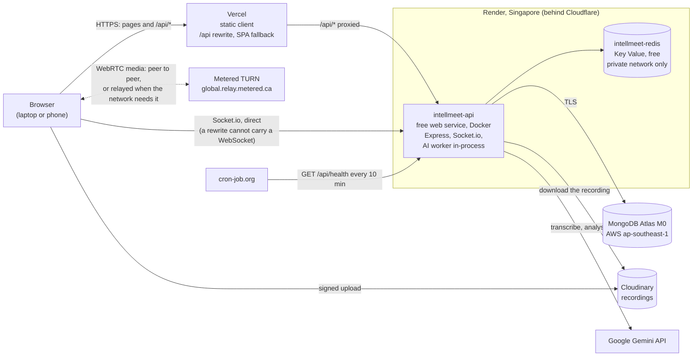

# Deployment (Phase 12)

How the live demo runs, how it was set up, and how to keep it running: every
service, every environment variable, redeploying and rolling back, rotating
each key, the keep-alive, the free-tier limits, and what to do when something
breaks.

| What | URL |
| --- | --- |
| **Web app** | <https://intellmeet-ai-meeting-platform-clie.vercel.app> |
| API (health) | <https://intellmeet-api-n55x.onrender.com/api/health> |

Share only the web app's domain. Vercel also serves each deployment on longer
aliases, and the API refuses those (see [CORS](#cors-and-vercel-previews)).

---

## Architecture



- **REST goes through Vercel.** The browser only ever calls `/api/...` on the
  page's own origin, and `client/vercel.json` rewrites it to Render. The
  refresh cookie is therefore first-party (`HttpOnly; Secure; SameSite=Lax;
  Path=/api/auth`, no `Domain`), and the client has no API base URL.
- **Socket.io goes straight to Render** (`VITE_SOCKET_URL`), because a Vercel
  rewrite cannot proxy a WebSocket upgrade. The access token travels in the
  handshake, not in a cookie.
- **Media never touches Render.** Browsers connect to each other; Metered
  relays the calls whose networks block a direct path.
- **Everything is in Singapore** except Vercel's edge and Gemini. From the API,
  MongoDB answers in 1-2 ms and Redis in 1-2 ms (the health endpoint reports
  both).

## Services

| Service | Plan | What it does here | Where it is configured |
| --- | --- | --- | --- |
| **Vercel** | Hobby (free) | Builds and serves the client; rewrites `/api/*` to Render; SPA fallback; security headers; one-year cache for hashed assets | Project settings (Root Directory `client`, Node 22.x) + `client/vercel.json` |
| **Render web service** `intellmeet-api` | Free: 512 MB, 0.1 CPU | The API, Socket.io and the BullMQ worker in one container, built from `server/Dockerfile` | `render.yaml` (Blueprint) + the dashboard for secrets |
| **Render Key Value** `intellmeet-redis` | Free: 25 MB, 50 connections, no persistence | BullMQ queue, Socket.io adapter, rate-limit counters, caches | `render.yaml` |
| **MongoDB Atlas** | M0 (free) | The database `intellmeet` on cluster `Cluster0` (project "IntellMeet", AWS Singapore) | Atlas UI |
| **Cloudinary** | Free (25 credits a month) | Meeting recordings: the host's browser uploads directly (signed), the worker downloads them | Cloudinary console + three Render variables |
| **Google Gemini** | Free tier | Transcription and analysis, `gemini-3.5-flash` falling back through 3.6, 3.7 and 3.8 Flash | A key in its own Google project, on Render |
| **Metered** | Free plan | TURN relay for calls on restrictive networks (mobile data, college and office firewalls) | Metered dashboard + three Render variables |
| **Brevo** | Free (300 emails a day) | Sends the sign-in codes, over its HTTPS API | Brevo console (a validated sender, an API key) + `render.yaml` + two Render secrets. See [Email sign-in codes](#email-sign-in-codes) |
| **cron-job.org** | Free | Keeps the free web service awake | cron-job.org job "IntellMeet keep-alive" |

Nothing here needs a card, and nothing bills past its free allowance: each
service stops or throttles at its limit (see [Free-tier limits](#free-tier-limits)).

---

## Environment variables

**Secrets live only in Render's dashboard** (and in a developer's own
`server/.env` while testing locally). `render.yaml` marks each one
`sync: false` and holds no value; Vercel holds no secrets at all; nothing
secret is committed. The values themselves are not in this document.

### Render: `intellmeet-api` → Environment

Set by `render.yaml` (changed by editing the file, see
[Redeploying](#redeploying)) unless the "Set by" column says otherwise.

| Variable | Production value | Default in code | Secret |
| --- | --- | --- | --- |
| `NODE_ENV` | `production` | `development` | no |
| `PORT` | injected by Render | `5000` | no |
| `NODE_OPTIONS` | `--max-old-space-size=384` (leaves room under 512 MB for ffmpeg and native memory) | - | no |
| `LOG_LEVEL` | `info` | `info` | no |
| `CORS_ORIGINS` | `https://intellmeet-ai-meeting-platform-clie.vercel.app` | `http://localhost:5173` | no |
| `CLIENT_URL` | the same domain (base of invite links) | `http://localhost:5173` | no |
| `MONGODB_URI` | **set in the dashboard**: Atlas SRV string with `/intellmeet` before the `?` | required | **yes** (database password) |
| `REDIS_URL` | wired by Render from the Key Value (`fromService`), a private-network `redis://` URL | required | internal, never typed |
| `JWT_SECRET` | generated by Render once (`generateValue`), kept across deploys | required, ≥ 32 characters | **yes** |
| `BCRYPT_COST` | `10` | `12` | no |
| `RATE_LIMIT_AUTH_PER_15_MIN` | `60` | `30` | no |
| `RATE_LIMIT_LOGIN_FAILURES_PER_15_MIN` | `10` | `5` | no |
| `RUN_WORKER_IN_PROCESS` | `true` | `true` | no |
| `AI_PROVIDER` | `gemini` | `mock` | no |
| `GEMINI_API_KEY` | **set in the dashboard** | required when `AI_PROVIDER=gemini` | **yes** |
| `GEMINI_MODEL` | `gemini-3.5-flash` | `gemini-3.5-flash` | no |
| `GEMINI_FALLBACK_MODELS` | `gemini-3.6-flash,gemini-3.7-flash,gemini-3.8-flash` | the same | no |
| `CLOUDINARY_CLOUD_NAME` | **set in the dashboard** | unset (recordings go to local disk) | no |
| `CLOUDINARY_API_KEY` | **set in the dashboard** | unset | kept private (it also reaches the host's browser inside each upload signature, which is harmless without the secret) |
| `CLOUDINARY_API_SECRET` | **set in the dashboard** | unset | **yes** |
| `TURN_URLS` | the four `global.relay.metered.ca` URLs (UDP and TCP on 80, UDP on 443, TLS on 443) | unset | no |
| `TURN_USERNAME` | **set in the dashboard** | unset | **yes** (see [TURN credentials](#turn-credentials-are-visible-to-signed-in-users)) |
| `TURN_CREDENTIAL` | **set in the dashboard** | unset | **yes** |
| `EMAIL_PROVIDER` | `brevo` | `console` (refused in production) | no |
| `BREVO_API_KEY` | **set in the dashboard** | required when `EMAIL_PROVIDER=brevo` | **yes** |
| `EMAIL_FROM_ADDRESS` | **set in the dashboard**: an address Brevo has validated as a sender | required when `EMAIL_PROVIDER=brevo` | no (it is on every email) |
| `EMAIL_DAILY_LIMIT` | `250` | `250` | no |

Not set on Render, so the code default applies (all documented in
`server/.env.example`; the tuning ones are in the README's "Demo-day
tuning" table):

| Variable | Default | Variable | Default |
| --- | --- | --- | --- |
| `SHUTDOWN_TIMEOUT_MS` | 10000 | `RATE_LIMIT_DEMO_PER_15_MIN` | 60 |
| `ACCESS_TOKEN_TTL_SEC` | 900 | `RATE_LIMIT_REFRESH_PER_15_MIN` | 600 |
| `REFRESH_TOKEN_TTL_DAYS` | 7 | `LIVE_MEETING_IDLE_MIN` | 10 |
| `REFRESH_REUSE_GRACE_MS` | 10000 | `DEMO_BOARD_RESET_IDLE_MIN` | 60 |
| `MAX_SESSIONS_PER_USER` | 20 | `STUN_URLS` | Google's two public STUN servers |
| `DEMO_EMAIL` | `demo@intellmeet.app` | `AI_MAX_FILE_MB` / `AI_CHUNK_SECONDS` | 24 / 600 |
| `DEMO_DATA_TTL_HOURS` | 6 | `AI_JOB_ATTEMPTS` / `AI_JOB_BACKOFF_MS` | 3 / 10000 |
| `DEMO_CLEANUP_INTERVAL_MIN` | 30 | `RECORDINGS_DIR` / `MAX_RECORDING_MB` | `.data/recordings` / 50 (unused with Cloudinary) |
| `DEMO_MAX_GUESTS` | 200 | `FFMPEG_PATH` | the bundled ffmpeg |
| `LOGIN_CODE_TTL_MIN` | 10 | `LOGIN_CODE_RESEND_SEC` / `LOGIN_CODE_MAX_ATTEMPTS` | 60 / 5 |
| `RATE_LIMIT_CODE_REQUEST_PER_15_MIN` | 10 | `EMAIL_FROM_NAME` | `IntellMeet` |

`GROQ_API_KEY`, `GROQ_TRANSCRIBE_MODEL` and `GROQ_CHAT_MODEL` are not used in
production (Groq is supported but not selected).

### Vercel: Project → Settings → Environment Variables

| Variable | Value | Secret |
| --- | --- | --- |
| `VITE_SOCKET_URL` | `https://intellmeet-api-n55x.onrender.com` | no: every `VITE_` value is inlined into the public bundle at build time, so a change needs a redeploy |

That is the only one. `VITE_SENTRY_DSN` arrives with Phase 13.
`VITE_DEV_API_PROXY` is for local development only.

---

## Setup, step by step (as it was done)

1. **Region: Singapore for everything that can choose.** Atlas and Render in
   the same AWS region keep every database round trip to 1-2 ms.
2. **MongoDB Atlas.** Project "IntellMeet", an **M0** cluster "Cluster0" on
   AWS Singapore (`ap-southeast-1`). One database user with an
   autogenerated password ("Read and write to any database"). **Network
   Access: `0.0.0.0/0`**, because Render's free services have no fixed
   outbound address; the protection is the long random password and TLS.
   The connection string gets the database name before the query:
   `mongodb+srv://<user>:<password>@<cluster-host>/intellmeet?retryWrites=true&w=majority`.
   It is kept privately and entered only on Render.
3. **Redis: nothing to sign up for.** The Blueprint (step 7) creates the Key
   Value instance and wires `REDIS_URL`. Render Key Value was chosen over
   Upstash, whose free 500K commands a month would run out in about nine
   days: BullMQ's idle polling and the health checks alone send about 55,000
   commands a day.
4. **Cloudinary.** A free account. In **Settings → Security**, the "Fetched
   URL" (image) and "Fetch" (video) delivery types are restricted, so the
   account cannot be used to fetch arbitrary URLs. The cloud name, API key and
   API secret are entered on Render.
5. **Gemini.** A new API key in a new Google Cloud project made for this
   deployment (Google AI Studio → Get API key → Create API key → that
   project), entered on Render. Free-tier quotas are per project.
6. **Metered.** The Free plan; **TURN Server → Credentials → Create
   Credential** (no expiry, region Global). The username and credential are
   entered on Render; the URLs are in `render.yaml`.
7. **Render Blueprint.** **New → Blueprint**, the GitHub repository, branch
   **`main`**. Render reads `render.yaml`, creates `intellmeet-api` and
   `intellmeet-redis`, and asks once for every `sync: false` value. The first
   deploy failed its health check twice, both times on `MONGODB_URI` (an old
   cluster's connection string, then a typo with an extra `?/`); both were
   fixed under **Environment**, then **Save and deploy**. See
   [Troubleshooting](#troubleshooting).
8. **Vercel.** **Add New → Project**, the same repository. Framework preset
   **Vite**, **Root Directory `client`**, environment variable
   `VITE_SOCKET_URL`, Deploy. Then **Settings → Build and Deployment**:
   **Node.js 22.x**, and **"Include files outside the root directory in the
   Build Step" enabled** (the build runs `cd ..` to build `shared/` first).
   The install and build commands and the output folder come from
   `client/vercel.json`. The production domain then went into
   `CORS_ORIGINS` and `CLIENT_URL` in `render.yaml`.
9. **Seed production** from a laptop, in PowerShell. `Read-Host` keeps the
   connection string out of the shell history, and the variables last only
   for that window:

   ```powershell
   $env:MONGODB_URI = Read-Host 'Atlas connection string'
   $env:BCRYPT_COST = '10'   # a hash keeps the cost it was made with
   npm run seed -w @intellmeet/server
   Remove-Item Env:MONGODB_URI, Env:BCRYPT_COST
   ```

   Expected: `Team: IntellMeet Demo Team (intellmeet-demo), 4 members`, three
   sample meetings, 22 history meetings, 6 sample tasks and 13 finished
   history tasks. Production's Redis is private, so the seed cannot reach it;
   it carries on (the only effect is that cached analytics expire within 5
   minutes). It is idempotent: running it again updates in place.
10. **Keep-alive** on cron-job.org (see [Keep-alive](#keep-alive)).
11. **Brevo**, for the sign-in codes (below). Done after the rest, when the
    email sign-in was added.

---

## Email sign-in codes

Signing up and signing in with a six-digit code needs something to send the
email. It has to be an **HTTPS API, not SMTP**: Render's free web services have
blocked outbound traffic to the SMTP ports (25, 465, 587) since 26 September
2025 ([Render's changelog](https://render.com/changelog/free-web-services-will-no-longer-allow-outbound-traffic-to-smtp-ports)),
so a mail library would time out in production and work on a laptop. Brevo's
free plan (300 emails a day) has a transactional API; `EMAIL_PROVIDER=brevo`
uses it. Until it is set up the server answers the code endpoints with 503
("Signing in with an email code is not available right now") and everything
else works: it never falls back to printing codes in the log.

### Setting it up

Every secret is entered by its owner in the dashboard it belongs to: never in
chat, a file in the repository or a shell history.

1. **An account** at [brevo.com](https://www.brevo.com), free plan.
2. **A sender.** In Brevo: **Settings → Senders, Domains, IPs → Senders → Add a
   sender**, with a from name and the address the codes will come from. For an
   address whose domain is not authenticated, Brevo emails it a **6-digit
   code**; enter it under **Verify sender**
   ([Brevo: create a sender](https://help.brevo.com/hc/en-us/articles/208836149)).
   The sender counts only once verified (`active` in the API). Menu names
   change; what is needed is *one verified sender*.
3. **An API key.** **Settings → SMTP & API → API keys** (direct link:
   `app.brevo.com/settings/keys/api`) → **Generate a new API key**: a name, an
   expiry if wanted, and an **API key, not an SMTP key**. It is shown once. It
   goes only into Render (and a private `server/.env` for a local test).
4. **Render, before the deploy that needs it.** `render.yaml` selects
   `EMAIL_PROVIDER=brevo`, and the server **refuses to start** with it and
   either value empty (`[env] Invalid environment configuration`). So on
   `intellmeet-api` → **Environment**, set **`BREVO_API_KEY`** (the key) and
   **`EMAIL_FROM_ADDRESS`** (the confirmed sender), then **Save**, and only then
   merge the change. (Render may also ask for them when it syncs the Blueprint;
   if the deploy starts without them it fails and the old one keeps running:
   fill them in and **Save and deploy**.)
5. **Check the pair without sending anything**, in PowerShell. The key is typed
   at a hidden prompt, so it is never on the screen or in the history:

   ```powershell
   $key = Read-Host 'Brevo API key' -AsSecureString
   $headers = @{ 'api-key' = [System.Net.NetworkCredential]::new('', $key).Password; accept = 'application/json' }
   (Invoke-RestMethod https://api.brevo.com/v3/account -Headers $headers).plan   # a 4xx names the problem
   (Invoke-RestMethod https://api.brevo.com/v3/senders -Headers $headers).senders | Select-Object email, active
   Remove-Variable key, headers
   ```

   The first call accepts or refuses the key; the second lists the senders:
   `EMAIL_FROM_ADDRESS` must be there with `active` true.
6. **Try it live** with a mailbox you own: sign up on the production site, find
   the email (and the spam folder), enter the code, sign out, sign in with a
   code again. Brevo → **Transactional** → **Logs** shows each message and what
   became of it.

### What is not known until it runs

- **Whether the emails reach the inbox, and from which address.** The suite
  stubs the provider. One verified address works without a domain of your own
  (step 2), but Brevo says addresses on free mailbox providers (`gmail.com`,
  `yahoo.com`) **cannot be domain-authenticated**, that domain authentication
  has been mandatory since 1 February 2024 (Gmail's and Yahoo's sender rules),
  and that until a domain is authenticated it may **replace the domain part of
  the from address with `@brevosend.com`** to keep delivering
  ([Brevo: authenticate your domain](https://help.brevo.com/hc/en-us/articles/12163873383186)).
  So codes may arrive from a `brevosend.com` address, or land in spam. Whether
  that rewrite applies to API sends was not confirmed. A domain you own,
  authenticated with the DNS records Brevo gives you, is the reliable setup.
  The screen tells people to check their spam folder.

### What it costs, and the limits

- **300 emails a day** on the free plan. `EMAIL_DAILY_LIMIT` (250) stops the
  server asking for more: at the ceiling the code endpoints answer 503
  ("Signing in with an email code is busy right now") for the rest of a 24-hour
  window that starts at the first request, not at Brevo's day boundary.
  Passwords and the demo carry on. The count lives in Key Value, which keeps
  nothing on disk: a restart zeroes it, and Brevo itself then refuses past 300
  (the person sees "We couldn't send the email").
- **Per address:** one email a minute and five per 15 minutes, whoever asks,
  whether or not the address has an account. **Per IP:** 10 code requests per
  15 minutes (`RATE_LIMIT_CODE_REQUEST_PER_15_MIN`).
- **A determined caller can spend the day's allowance** with many addresses
  from many networks. The effect is the 503 above until the window ends; it
  cannot read or change anything.
- **`docker-compose.prod.yml` and Kubernetes** run `NODE_ENV=production`, so the
  code endpoints answer 503 there unless `EMAIL_PROVIDER=brevo` and its two
  values are set (the chart's values do not list them). Passwords and the demo
  are unaffected.
- **Locally**, `EMAIL_PROVIDER=console` (the default) prints each email, the
  code included, in the terminal running `npm run dev`.

---

## Redeploying

**The normal path is a merge to `main`.**

| | Vercel (client) | Render (API) |
| --- | --- | --- |
| Triggered by | every push to `main` (and a preview for every other branch) | every push to `main` that touches `server/`, `shared/`, the root `package.json` / `package-lock.json`, `tsconfig.base.json` or `.dockerignore` (`buildFilter`) |
| Waits for CI | no: it builds at once | **yes**: `autoDeployTrigger: checksPass` deploys a commit only once all of its GitHub checks have passed (CI checks, e2e, both image builds) |
| Takes | about a minute | a few minutes to build, then about a minute to pass the health check |

Because Vercel does not wait and Render does, a client change can be live
for a few minutes before the API change it depends on. Keep API changes
backward compatible (add first, remove later) and this never matters.

**Render's Blueprint follows `main`.** It was created from `main` after
Phase 12's first PR merged, and syncs `render.yaml` from there: a change to
the file on `main` is applied to both services. Values written in
`render.yaml` are reapplied on every sync, so change them in the file, not in
the dashboard (a dashboard edit is overwritten by the next sync).
`sync: false` values are never touched by a sync; they live in the dashboard.

**By hand:**

- **Render:** `intellmeet-api` → **Manual Deploy** → **Deploy latest commit**
  (or **Clear build cache & deploy** if a dependency looks stale).
- **Vercel:** **Deployments** → the latest production deployment → **⋯** →
  **Redeploy**.
- **After changing a variable on Render:** **Save and deploy**; no rebuild is
  needed (the image does not contain the environment).
- **After changing `VITE_SOCKET_URL` on Vercel:** redeploy, because it is
  inlined at build time.

---

## Rolling back

- **Render:** `intellmeet-api` → **Events** → a previous successful deploy →
  **Rollback**. It redeploys that build without rebuilding. Afterwards check
  **Settings → Auto-Deploy**: if Render turned it off so the next push does
  not undo the rollback, turn it back on once `main` is fixed.
- **Vercel:** **Deployments** → the previous production deployment → **⋯** →
  **Instant Rollback**.
- **Then fix `main`** (a revert commit), so the next deploy is the good code.
- **Data:** no deploy in this project migrates data; schema changes have been
  additive, so running older code against the current database is safe.
  Atlas M0 has no backups; the demo data can always be rebuilt with the seed.

---

## Rotating keys

The pattern for each: make the new credential, put it on Render, **Save and
deploy**, wait for "Deploy live", then revoke the old one.

| Key | How |
| --- | --- |
| **`MONGODB_URI`** (Atlas password) | Atlas → **Database Access** → **Add New Database User** (autogenerated password, same role) → build the new connection string → Render → `MONGODB_URI` → Save and deploy → once live, delete the old user. Two users for a moment means no outage. Update your private copy used for seeding. |
| **`JWT_SECRET`** | Generate 32 random bytes locally (`node -e "console.log(require('crypto').randomBytes(32).toString('base64'))"`) and paste the value into Render's `JWT_SECRET` yourself → Save and deploy. **Nobody is signed out:** access tokens last 15 minutes, and the refresh tokens that carry sessions are random values stored hashed in MongoDB, not JWTs. An old access token gets a 401, the client refreshes once and carries on; a socket refused at the handshake does the same. |
| **`GEMINI_API_KEY`** | Google AI Studio → **API keys** → create a key in the same project → Render → Save and deploy → delete the old key. A key in the same project shares its daily quota. |
| **`CLOUDINARY_API_KEY` + `CLOUDINARY_API_SECRET`** | Cloudinary console → **Settings → API Keys** → generate a new pair → Render (both variables) → Save and deploy → deactivate the old pair. Recordings already stored keep working: their delivery URLs carry no key. |
| **`TURN_USERNAME` + `TURN_CREDENTIAL`** | Metered → **TURN Server → Credentials** → create a credential → Render (both variables) → Save and deploy → delete the old credential once the calls running on it have ended. Browsers fetch the credential for each call (cached privately for 60 s). |
| **`REDIS_URL`** | Nothing to rotate: no public endpoint and no password; Render wires the URL. |

---

## Keep-alive

Render's free web services **sleep after 15 minutes without traffic**, and
the first request after that waits about a minute while the container starts
(the image took 53 s to pass its health check at 0.1 CPU). A judge should
never meet that.

**cron-job.org job "IntellMeet keep-alive":** `GET
https://intellmeet-api-n55x.onrender.com/api/health` every **10 minutes**,
with failure notifications on. `/api/health` needs no auth, always answers
200 while the process is up, checks MongoDB and Redis on the way, and is left
out of the request log so the pings do not bury real traffic.

- **What it costs:** the service then runs all month: 720-744 of the
  workspace's **750 free instance hours**. A second free web service in the
  same Render workspace would run both out before the month ends.
- **To let it sleep** (between demo weeks, to save hours): disable the job on
  cron-job.org. Re-enable it at least ten minutes before anyone uses the site,
  or open `/api/health` once yourself and wait for the 200.
- **Its history** on cron-job.org is a free uptime record: every failed ping is
  listed with its status code.

---

## Free-tier limits

| Service | Limit | What happens at it | This app |
| --- | --- | --- | --- |
| Render web service | 750 instance hours a month per workspace; sleeps after 15 min idle; 512 MB, 0.1 CPU; the disk is wiped on every deploy | The service stops until the month ends; a sleeping one wakes in about a minute | Kept awake: 720-744 h. Heap capped at 384 MB. Recordings go to Cloudinary, never to disk |
| Render Key Value | 25 MB, 50 connections, **no persistence** | A restart comes back empty: queued AI jobs, rate-limit counters, caches and presence are gone | 6 connections per API instance. Lost AI jobs are marked failed after 10 minutes with a Retry button (the recovery sweep). `noeviction`, so a full instance refuses writes instead of silently dropping queued jobs |
| MongoDB Atlas M0 | 512 MB storage, shared CPU, no backups | Writes fail when full | The seeded demo is a few MB; the demo cleanup removes guests and their data after 6 idle hours |
| Gemini free tier | **20 requests a day per model, failed ones included**; resets at midnight Pacific (12:30 IST during US daylight saving time, 13:30 IST otherwise); busy hours answer 503 | 429, then the next model in the chain; the meeting page shows the failure and a Retry button when all four are spent | A recorded meeting needs 2-3 requests; four models give about 40 meetings a day across all users |
| Cloudinary | 25 credits a month (a credit is 1 GB stored, 1 GB delivered or 1,000 transformations) | Uploads and delivery stop | A one-hour recording at 32 kbps is about 14 MB; deleting a meeting deletes its recording |
| Metered TURN | **500 MB a month**, the conservative figure: the pricing page says "Free Trial 500 MB", while the TURN dashboard shows "0 GB / 50 GB used" | The relay stops, **with no charge** (auto-reload is off); calls that need a relay fail, direct calls are unaffected | Only relayed calls use it. A relayed two-person video call moves an estimated 20-45 MB a minute (two streams of about 1.5 Mbps, counted once or in both directions), so 500 MB is roughly 10-25 minutes of relayed video: keep phone-on-mobile-data tests short |
| Vercel Hobby | Bandwidth and build allowances on the usage page | Deployments pause | A static site of about 155 kB gzipped on first load; nowhere near |
| cron-job.org | Free | - | One job every 10 minutes |
| Brevo | 300 emails a day | Sending is refused (HTTP 4xx); the person sees "We couldn't send the email" | `EMAIL_DAILY_LIMIT=250` stops requests first with a 503; one email a minute and five per 15 minutes per address; see [Email sign-in codes](#email-sign-in-codes) |

---

## Client IP addresses

Rate limits and the session record need the visitor's address, and on
Render, Express's `req.ip` is not it. Production has two paths to the API:

```
REST:    browser → Vercel (rewrite) → Cloudflare → Render's proxies → API
Socket:  browser ───────────────────→ Cloudflare → Render's proxies → API
```

Measured before the fix: `req.ip` (with `trust proxy: 1`) was one of Render's
own proxy addresses, so **every visitor shared one or two rate-limit
buckets**. A room of judges would have been a single "IP", and so would the
whole internet.

`server/src/lib/clientIp.ts` reads the address from what the proxies add:

- **Cloudflare sets `CF-Connecting-IP`** to whoever connected to it, and
  refuses a request that already carries one (error 1000), so a caller cannot
  forge it. On the direct path that is the visitor.
- **On the REST path it is Vercel.** Vercel overwrites `X-Forwarded-For` with
  the visitor's address (it does not pass on one the browser sent), and
  Cloudflare appends Vercel's. So the public address just before
  `CF-Connecting-IP` in `X-Forwarded-For` is the visitor.
- A private address in that position (a college or office gateway's) is not
  an identity and is skipped. With no `CF-Connecting-IP` at all (local
  development, tests, Docker Compose, Kubernetes) it is `req.ip`, as before.

**The trade-off:** a caller who bypasses Vercel and calls Render directly can
put any address before its own and pick its rate-limit bucket. Per-IP limits
therefore hold for everyone using the app normally, and the limits that must
hold against a deliberate attacker are keyed on something else:

| Limit (production) | Key | Budget per 15 min |
| --- | --- | --- |
| Session refresh | visitor IP | 600 |
| "Try Live Demo" | visitor IP | 60, and at most `DEMO_MAX_GUESTS` (200) guests in total |
| Register + password sign-in | visitor IP | 60 (`RATE_LIMIT_AUTH_PER_15_MIN`) |
| Failed sign-ins | visitor IP + email | 10 (`RATE_LIMIT_LOGIN_FAILURES_PER_15_MIN`) |
| **Failed sign-ins** | **account (email), any address** | **30, fixed** |
| Board edits, analytics reads | signed-in account | 120 a minute |

**Checked live on 26 September 2026**, from one laptop:

| Request | `RateLimit` counter |
| --- | --- |
| Refresh direct to Render, then through Vercel, alternating | one counter, down by one each time (594, 593, 592, 591) |
| Through Vercel with a forged `X-Forwarded-For` | the same counter (590): Vercel discards the header |
| Direct to Render with a forged `X-Forwarded-For` | a new counter (599): the documented trade-off |
| Register with an empty body | `limit=60` (`RATE_LIMIT_AUTH_PER_15_MIN` in effect) |
| 11 failed sign-ins for one unknown email | ten 401s, then 429 "Too many sign-in attempts" (the limit of 10 in effect) |

---

## Security notes

- **Secrets:** only on Render, entered by hand; `render.yaml` holds none
  (`sync: false`), `.env` files are git-ignored, and `.dockerignore` keeps
  them out of every image.
- **Cookies:** the refresh cookie is `HttpOnly; Secure; SameSite=Lax;
  Path=/api/auth`, first-party through the rewrite. The access token lives
  in memory only.
- **Key Value:** `ipAllowList: []`, so it has no public endpoint at all.
- **Atlas:** open to `0.0.0.0/0` (Render's free plan has no fixed outbound
  address), protected by an autogenerated password and TLS. To tighten it,
  allow only the ranges under `intellmeet-api` → **Connect → Outbound**; they
  are shared with other Render customers, and your own address must then be
  added before each seed.
- **Cloudinary:** the browser can only upload, signed, into
  `intellmeet/recordings`; the API accepts only the exact delivery URL of the
  named recording (no fetch URLs, other assets, transformations or query
  strings) and downloads it without following redirects. Deleting a meeting
  (by its host, the demo cleanup or a guest's own session ending) deletes the
  recording; Cloudinary's CDN may keep serving a cached copy for a few
  minutes while the invalidation spreads.

### CORS and Vercel previews

The API and the Socket.io handshake accept exactly one origin, the
production domain. A preflight from anywhere else gets 403, and so does a
`POST` from any other origin, including Vercel's longer aliases for the same
deployment and **preview deployments**: a preview shows its pages but cannot
sign in. That is deliberate, since previews would otherwise write to the
production database through the rewrite. Test changes locally, or on
production after merging.

### TURN credentials are visible to signed-in users

A browser cannot use a TURN server without its credential, so
`GET /api/rtc/ice-servers` gives it to every signed-in user, and "Try Live
Demo" makes anyone a signed-in user. It is never in the public bundle, but a
determined visitor can read it and relay traffic through the account. The
damage is bounded: the free plan stops at its quota with no charge. If the
usage graph shows traffic nobody made, rotate the credential.

---

## Troubleshooting

| Symptom | Cause and fix |
| --- | --- |
| The first request takes about a minute, or fails once and then works | A cold start: the service was asleep. Check the keep-alive job's history on cron-job.org. |
| A deploy never goes live; the log says `[env] Invalid environment configuration` | A variable is missing or malformed; the message names it. |
| Deploy log: `querySrv ENOTFOUND` | The cluster hostname in `MONGODB_URI` is wrong, e.g. an old cluster's string. Copy it again from Atlas → **Connect → Drivers**. |
| Deploy log: `bad auth : authentication failed` | Wrong user or password. Special characters in the password (`@ : / ? # [ ] %`) must be percent-encoded. |
| Deploy log: a `MongoParseError`, or the database is not `intellmeet` | A typo in the path. It must be exactly `...mongodb.net/intellmeet?retryWrites=...`: one `/`, the name, one `?`. An extra `?/` was one of the two first-deploy failures. |
| Deploy log: `Server selection timed out`, or TLS errors | Atlas refuses the connection: **Network Access** must list `0.0.0.0/0` as Active, and the cluster must not be paused. |
| The browser console shows 403 `Origin ... is not allowed by CORS` | The page is not on the production domain (an alias or a preview), or `CORS_ORIGINS` is not exactly `https://intellmeet-ai-meeting-platform-clie.vercel.app` (https, no trailing slash). |
| Signed out on every reload | The refresh cookie did not stick: use the production domain. A 429 on `/api/auth/refresh` means the refresh limit was hit. |
| 429 "Too many requests" / "Too many sign-in attempts" | The limits above. Raise them in `render.yaml` if a real room hits them. |
| A room link opens "You're not in this meeting's team", "No meeting has that code" or "This meeting has ended" (before the join fix, all three said "That meeting is not available") | Three different causes; see [A room link does not open](#a-room-link-does-not-open) below. |
| 503 "Demo mode is not available: the demo workspace has not been seeded" | Run the seed (step 9). |
| 503 "The demo is busy right now" | `DEMO_MAX_GUESTS` guests exist. The sweep removes guests idle for 6 hours; raise the ceiling on Render if needed. |
| A deploy never goes live; the log says `BREVO_API_KEY: required when EMAIL_PROVIDER=brevo` (or `EMAIL_FROM_ADDRESS`) | The two values were not set before the deploy that selects Brevo. Set them under **Environment**, then **Save and deploy**. The old deploy keeps running meanwhile. |
| 503 "Signing in with an email code is not available right now" | `EMAIL_PROVIDER` is `console` in production (never used there): set it to `brevo` with its two values. |
| 503 "Signing in with an email code is busy right now" | `EMAIL_DAILY_LIMIT` emails were sent in the last 24 hours. It clears by itself; passwords and the demo still work. |
| 503 "We couldn't send the email" | Brevo refused it. The log line `[auth] sign-in email was not sent` has Brevo's reason: `api-key not found` (a wrong or revoked key), an unvalidated or unknown sender (check **Senders**, and the PowerShell check above), or a daily quota spent (300). |
| People say the code never arrives | Spam folder first; then Brevo → **Transactional** → **Logs** for what became of the message. An address with no account that asked to *sign in* gets an email saying so, and one that has an account and asked to *sign up* gets one saying to sign in: neither contains a code. |
| 429 "Please wait a moment before asking for another code" | The one-a-minute limit per address. The button counts it down; a script ignoring it gets this. |
| Stopping a recording shows "Cloudinary rejected the upload (HTTP 401)" | Cloudinary refused the key Render signs with; see [Recording upload refused (HTTP 401)](#recording-upload-refused-http-401) below. Open on production since the Phase 12 smoke test. |
| The meeting page shows the AI failed with HTTP 429 | Gemini's daily quota is spent on all four models. Retry after midnight Pacific. Check usage at <https://aistudio.google.com/rate-limit>. |
| ... with HTTP 503 | Gemini is overloaded. The chain already tried every model; press Retry in a few minutes. |
| AI status stuck at "queued" or "transcribing" | The Key Value instance restarted and lost the job. After 10 minutes the recovery sweep marks it failed ("Processing was interrupted...") and the host can Retry. |
| A call never connects for someone on mobile data or a strict network | The relay: if the room shows the amber "Running on STUN only" notice, the TURN variables are missing; otherwise check the Metered quota. |
| Camera or microphone blocked | The site must be on HTTPS (it is), and the browser's site permission must allow them; `Permissions-Policy` allows camera, microphone and screen sharing for this site only. |
| The Vercel build fails at `cd ..` or cannot find `@intellmeet/shared` | "Include files outside the root directory in the Build Step" is off, or the Root Directory is not `client`. |

Logs: Render → `intellmeet-api` → **Logs** (pino JSON, one line per request,
each with the `requestId` that error responses also carry). Vercel →
**Deployments** → a deployment → **Build Logs**.

### A room link does not open

`GET /api/meetings/code/:roomCode` refuses a room code in one of three ways,
and the room page names each one. A room code only opens a meeting for
members of the meeting's team; it is not a pass.

| Page heading | API | Cause | Fix |
| --- | --- | --- | --- |
| You're not in this meeting's team | 403 `FORBIDDEN` | The person is signed in, but not a member of the meeting's team. Usually they **signed up** instead of using Try Live Demo: every demo guest is in IntellMeet Demo Team, a registered account is not, and guests cannot create team invites. | Sign out, open the link again, choose **Try Live Demo**. For a meeting in a team of your own, a team admin sends a team invite link first. |
| No meeting has that code | 404 `NOT_FOUND` | A typo; a **team invite code** (8 characters) typed as a room code (7); or the meeting was deleted with its guest host (**End demo session**, or the 6-hour idle-guest sweep). | Copy the code from the room's **Invite** button. Paste a team invite into **Join with a code**, which now recognises it. |
| This meeting has ended | 409 `CONFLICT` | The host pressed **End for all**, or nobody had been in the room for `LIVE_MEETING_IDLE_MIN` (10) minutes and the sweep ended it. A host who clicks **Start now** and waits in the lobby without pressing **Join** is not in the room. | Start a new meeting and have the host join the room before sending the link. |

A signed-out link goes to the sign-in page. **Try the live demo** there, or
**Try Live Demo** on the landing page, lands the visitor in the room.

To see which one somebody hit, search the Render logs for the room code: the
`warn` line for `/api/meetings/code/<CODE>` carries the message (`This meeting
belongs to a team you're not in...`, `No meeting found for that code` or `That
meeting has already ended`). Before the join fix the first one was logged as
`Team not found`.

### Recording upload refused (HTTP 401)

The host's browser uploads the recording straight to Cloudinary, signed by
the API with `CLOUDINARY_API_SECRET`. A 401 is Cloudinary refusing the key:
it is unknown or deactivated, the secret belongs to a different key, or
`CLOUDINARY_CLOUD_NAME` is another account's. The app shows only the status;
Cloudinary's own message is in DevTools → **Network** → the
`api.cloudinary.com` request → **Response**.

To test the exact pair Render holds without pasting the secret anywhere,
copy each value from Render → `intellmeet-api` → **Environment** into its
prompt:

```powershell
$cloud  = Read-Host 'CLOUDINARY_CLOUD_NAME'
$key    = Read-Host 'CLOUDINARY_API_KEY'
$secret = Read-Host 'CLOUDINARY_API_SECRET'
curl.exe -s -u "${key}:${secret}" "https://api.cloudinary.com/v1_1/$cloud/ping"
Remove-Variable cloud, key, secret
```

`{"status":"ok"}` means the pair is valid, and the cause is elsewhere: read
Cloudinary's message from one more upload. An error message names the
problem. To fix it: Cloudinary Console → Settings → **API Keys**, an
**Active** key, its key and secret into Render's `CLOUDINARY_API_KEY` and
`CLOUDINARY_API_SECRET`, **Save and deploy**; then record 30 seconds and
stop, and the upload must succeed.

---

## Before a demo

- [ ] **The day before:** `/api/health` answers 200 with `mongo` and `redis`
      `up`; the keep-alive's history on cron-job.org is all 200s.
- [ ] **Quotas:** Metered and Cloudinary usage well below their limits. Do
      the rehearsal recording after Gemini's reset (12:30 IST), so the demo
      day starts with the whole allowance.
- [ ] **Clean slate (optional, the evening before):** guests idle for 6
      hours are swept anyway. To clear everything but the seed, run the
      cleanup the way the seed was run (`$env:MONGODB_URI = Read-Host ...`,
      then `npm run demo:cleanup -w @intellmeet/server -- 0`) with local
      Redis running. It also signs out anyone still in a demo session.
      Recordings it deletes are removed from Cloudinary only when the three
      `CLOUDINARY_` variables are set in that session too (it warns for each
      one it cannot remove); the server's own sweep has them.
- [ ] **30 minutes before:** open the site; **Try Live Demo** in two browsers
      and hold a one-minute call; the room must not show "Running on STUN
      only". Record 30 seconds and stop: the upload must succeed (see
      "Recording upload refused (HTTP 401)").
- [ ] **A phone on mobile data** (Wi-Fi off) joins the same call for a
      minute, which is the case TURN is for.
- [ ] **Share only** <https://intellmeet-ai-meeting-platform-clie.vercel.app>.
- [ ] **A fallback:** `npm run dev` on the laptop runs the whole product with
      no accounts (mock AI, local recordings).
